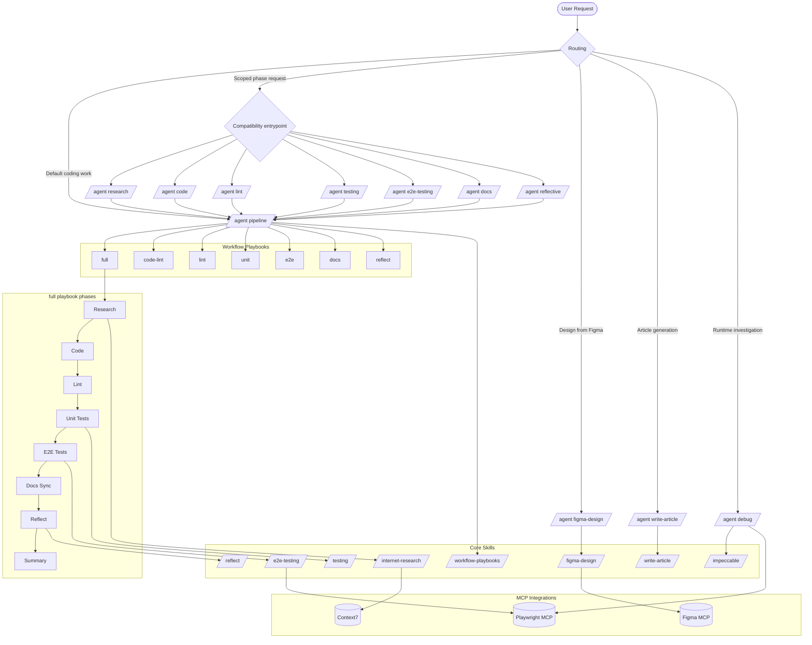

# .github Agentic Workflow

This repository uses a **playbook-first orchestration model**: one primary agent (`pipeline`) plus stable compatibility entry points (`code`, `lint`, `testing`, `e2e-testing`, `docs`, `reflective`, `research`).

## Workflow Flowchart

## Skills

| Skill | Location | Purpose |
|---|---|---|
| `workflow-playbooks` | `skills/workflow-playbooks/SKILL.md` | Canonical phase contracts and playbook definitions |
| `internet-research` | `skills/internet-research/SKILL.md` | Dependency and API research before coding |
| `testing` | `skills/testing/SKILL.md` | Jest + RTL unit/component test authoring and repair |
| `e2e-testing` | `skills/e2e-testing/SKILL.md` | Playwright e2e authoring and repair |
| `figma-design` | `skills/figma-design/SKILL.md` | Figma-to-code implementation |
| `write-article` | `skills/write-article/SKILL.md` | Research-backed technical article drafting |
| `pr-publishing` | `skills/pr-publishing/SKILL.md` | PR creation and reviewer-ready description generation |
| `reflect` | `skills/reflect/SKILL.md` | Failure logging and rule extraction |
| `impeccable` | `skills/impeccable/SKILL.md` | Frontend design critique and refinement |

## Compatibility Policy

- Existing entry points remain stable (`/agent lint`, `/agent testing`, etc.).
- Compatibility agents map scoped requests into the pipeline playbook model.
- New orchestration behavior must be defined in `workflow-playbooks` first, then reflected in agents/instructions/docs.
- Cross-provider standard and adapters live in:
  - [AI_CONTRIBUTING.md](/Users/lenny/Projects/lennypeters/.github/skills/workflow-playbooks/AI_CONTRIBUTING.md)
  - [openai-codex.md](/Users/lenny/Projects/lennypeters/.github/skills/workflow-playbooks/adapters/openai-codex.md)
  - [github-copilot.md](/Users/lenny/Projects/lennypeters/.github/skills/workflow-playbooks/adapters/github-copilot.md)
  - [opencode.md](/Users/lenny/Projects/lennypeters/.github/skills/workflow-playbooks/adapters/opencode.md)
